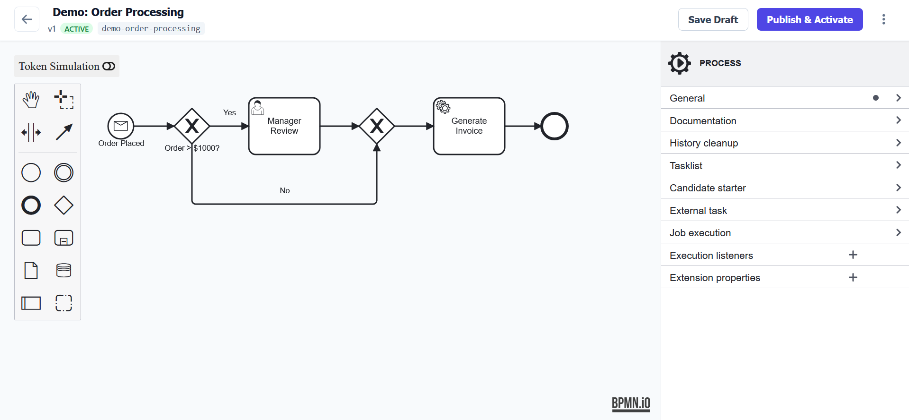

# **Saccharine BPMN for Laravel**



A lightweight, PHP-native BPMN 2.0 workflow orchestrator and visual designer for Laravel. Design long-running business processes visually and execute them as resilient, durable background jobs—**without external Java dependencies or enterprise runtime servers** (such as Camunda or Zeebe).

Saccharine BPMN bridges the gap between executable process diagrams and Laravel applications by pairing **bpmn-js** for interactive modeling with **durable-workflow** for stateful, queue-backed coroutines.

[**Live Sandbox**](demo.saccharine.app)

---

> **Status: v0.5.3-alpha**  
> Actively developed. The execution engine, state projection, live token tracking, and manual intervention layers are operational. Best suited for testing, evaluation, and community feedback.

* **Supported Elements**: Exclusive Gateways (condition expressions), Parallel Gateways (AND splits/joins via child coroutines), User Tasks (signals/wait states), Service Tasks (activity classes), Message Start Events (Eloquent model triggers), and Boundary Error/Timer events.
* **Roadmap / Open for Contribution**: Multi-instance loops, complex event sub-processes, dynamic form builders (e.g., `form-js`), and in-flight instance version migration.

---

## 50-Second Walkthrough

https://github.com/user-attachments/assets/4b4f7225-0dec-4d8d-819e-0c8678654207

1. **Model**: Configure dynamic parameters inside the visual designer and activate the version.
2. **Trigger**: An Eloquent `DemoOrder` event fires, matching the process start event.
3. **Hibernate**: The workflow evaluates an Exclusive Gateway and pauses at a User Task wait state.
4. **Resume & Deliver**: An operator submits the task from the Live Cockpit, resuming the coroutine and delivering a real notification to Mailpit.

---

## Quickstart

### 1. Require and Install

Install the package via Composer:

```bash
composer require saccharine/bpmn
```

Run the installation command to publish configuration, migrations, and frontend assets:

```bash
php artisan bpmn:install
```

### 2. Scaffold and Run the Demo

Scaffold the demo order workflow, sample activities, and trigger events:

```bash
php artisan db:seed --class='Saccharine\Bpmn\Database\Seeders\BpmnDemoSeeder'
```

```bash
php artisan bpmn:publish-filament-stubs
```

Start your queue worker to process workflow steps:

```bash
php artisan queue:work
```

In another terminal, trigger a test order:

```bash
php artisan bpmn:test-order --amount=250 --email=user@example.com
```

Navigate to the configurable web prefix (default: `/bpmn/workflows/definitions`) or your Filament admin panel to inspect the diagram and trace live execution tokens.

---

## Key Features

* **Zero External Services:** Runs on your existing Laravel queue infrastructure (database, Redis, SQS) using pure PHP coroutines.
* **Resilient & Crash-Proof:** Workflows persist state deterministically. If a queue worker crashes or restarts mid-task, execution resumes from the exact boundary node.
* **Integrated Visual Modeler:** Embedded, responsive drag-and-drop designer powered by `bpmn-js` with custom properties and element templates.
* **Event-Driven Triggers:** Automatically launch workflows from Eloquent model lifecycle hooks (`created`, `updated`, `deleted`) or custom domain events.
* **Parallel Splits & Synchronization:** Spawns concurrent child workflows at Parallel Gateways and joins execution paths cleanly without serialization errors.
* **Human-in-the-Loop Interventions:** Pause workflows indefinitely awaiting user forms or external webhooks, then resume execution seamlessly.
* **Filament & Standalone Ready:** Works out of the box with a built-in Blade dashboard or embeds cleanly into Filament admin panels.

---

## Technical Requirements

* **PHP 8.4**
* **Laravel Framework (^13.0)**
* **Symfony Expression Language (^7.0)**: Sandboxed evaluation of gateway condition expressions.
* **Durable Workflow (^1.0)**: Event-sourced coroutine engine for durable background execution.
* **bpmn-js**: Interactive client-side modeling and diagram visualization.


---

## Route Configuration

The package provides granular control over web and API routes through the `config/saccharine-bpmn.php` file.

*   **Web Prefix and Middleware:**
    ```php
    'prefix' => [
        'web' => 'bpmn/workflows', // Default web route prefix
    ],
    'middleware' => [
        'web' => ['web', 'auth'], // Default web middleware
    ],
    ```
    The web routes (including the standalone Blade dashboard) are accessible via the `prefix.web` configuration.

*   **API Prefix and Middleware:**
    ```php
    'prefix' => [
        'api' => 'api/bpmn', // Default API route prefix
    ],
    'middleware' => [
        'api' => ['api'], // Default API middleware
    ],
    ```
    API routes are optional and only registered if the `routes/api.php` file exists and contains content.

---

---

## Documentation

* [**Usage Guide**](docs/usage-guide.md): Comprehensive guide to routing, configuration, custom activities, triggers, element templates, and human tasks.
* [**Architecture & Internals**](docs/architecture.md): Deep dive into the XML relational parser, Strategy Pattern node handlers, parallel child workflows, and state projection.

---

## License & Acknowledgments

This package is open-source software licensed under the [MIT License](https://opensource.org/license/mit).

Saccharine BPMN would not be possible without the incredible work of the open-source community:

> * **bpmn-js** by bpmn.io / Camunda: The gold standard for web-based BPMN 2.0 visualization.
> * **durable-workflow**: The elegant coroutine orchestration layer that makes suspendable, durable PHP processes a reality.
> * Symfony & Laravel: For providing the ultimate foundation of modern enterprise PHP development.
