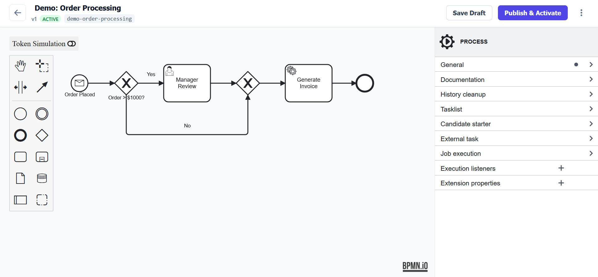

# **Saccharine BPMN for Laravel**



A lightweight, PHP-native BPMN 2.0 process orchestrator and visual designer for Laravel. Design long-running business processes visually and execute them as resilient, durable background jobs without external Java dependencies or enterprise runtime servers.

Saccharine BPMN bridges the gap between executable process diagrams and Laravel applications by pairing `bpmn-js` for interactive modeling with `durable-workflow` v2 for stateful, queue-backed PHP fibers.

* **Status:** `v0.6.0-alpha`
* **Execution Core:** Native PHP Fibers via `durable-workflow/workflow` v2.
* **Supported Elements:** Exclusive Gateways (condition expressions), Parallel Gateways (AND splits/joins via closure branches), User Tasks (synchronous update payloads and wait states), Service Tasks (activity classes), Message Start Events (Eloquent model triggers), and Boundary Error/Timer events.
* **Roadmap / Open for Contribution:** Multi-instance loops, complex event sub-processes, dynamic form builders (e.g., `form-js`), and in-flight process version migration.

---

## 50-Second Walkthrough


1. **Model:** Configure dynamic parameters inside the visual designer and activate the version.
2. **Trigger:** An Eloquent `DemoOrder` event fires, matching the process start event.
3. **Hibernate:** The process evaluates an Exclusive Gateway and pauses at a User Task wait state.
4. **Resume & Deliver:** An operator submits the task from the Live Cockpit, resuming execution and delivering an email notification via Mailpit.

---

## Quickstart

### 1. Require and Install

Install the package via Composer:

```bash
composer require saccharine/bpmn
```

Run the installation command to publish configuration and compiled frontend assets:

```bash
php artisan bpmn:install
php artisan migrate
```

### 2. Scaffold and Run the Demo

Scaffold the demo order process, sample activities, and trigger events:


```bash
php artisan db:seed --class='Saccharine\Bpmn\Database\Seeders\BpmnDemoSeeder'
```

```bash
php artisan bpmn:publish-filament-stubs
```

Start your queue worker to process workflow steps:

```bash
php artisan queue:work
```

In another terminal, trigger a test order:

```bash
php artisan bpmn:test-order --amount=250 --email=user@example.com
```

Navigate to `/bpmn/processes/definitions` (or your Filament admin panel) to inspect the diagram and trace live execution tokens.

---

## Key Features

* **Zero External Services:** Runs on your existing Laravel queue infrastructure (database, Redis, SQS) using pure PHP Fibers.
* **Resilient & Crash-Proof:** Processes persist state deterministically. If an infrastructure dependency fails or a server restarts, execution can route around exceptions using BPMN Error Boundary Events or resume from the exact boundary node.
* **Integrated Visual Modeler:** Embedded, responsive drag-and-drop designer powered by `bpmn-js` with filtered palettes, context pads, and element templates.
* **Event-Driven Triggers:** Automatically launch processes from Eloquent model lifecycle hooks (`created`, `updated`, `deleted`) or custom domain events.
* **Parallel Splits & Synchronization:** Spawns concurrent child workflows at Parallel Gateways using deferred closures and joins execution paths cleanly via `all()`.
* **Human-in-the-Loop Interventions:** Pause processes indefinitely awaiting user forms or administrative approvals, then resume execution seamlessly.
* **Filament & Standalone Ready:** Works out of the box with a built-in Blade dashboard or embeds cleanly into Filament admin panels with Filament Shield authorization.

---

## Technical Requirements

* **PHP:** `^8.3`
* **Laravel Framework:** `^^13.0`
* **durable-workflow/workflow:** `^2.0` (Native Fiber orchestration)
* **symfony/expression-language:** `^8.1` (Sandboxed evaluation of gateway conditions)
* **bpmn-js:** Embedded visual client-side modeling and tracking

---

## Documentation

* [Usage Guide](docs/usage-guide.md): Comprehensive guide to routing, configuration, custom activities, triggers, element templates, and human tasks.
* [Architecture & Internals](docs/architecture.md): Deep dive into relational graph decomposition, Fiber-based node handlers, parallel closure dispatch, and deterministic state projection.
* [Contributing Guidelines](CONTRIBUTING.md): Standards for testing with Pest, Orchestra Workbench, and code conventions.

---

## License & Acknowledgments

This package is open-source software licensed under the [MIT License](LICENSE.md).

Saccharine BPMN would not be possible without the incredible work of the open-source community:

* **[bpmn.io / Camunda](https://bpmn.io)** for creating `bpmn-js`.
* **[Richard McDaniel](https://github.com/rmcdaniel)** for `durable-workflow`.
* **[Symfony](https://symfony.com/)**
* **[Laravel](https://laravel.com/)**