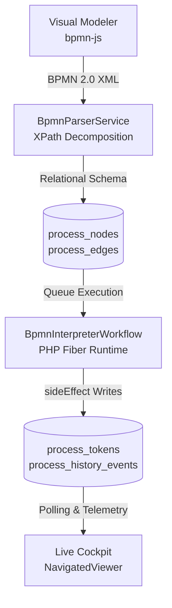

# Architecture, Internals & Roadmap

`saccharine/bpmn` decouples visual BPMN 2.0 modeling from host application logic by compiling OMG-compliant XML diagrams into an indexed relational schema executed by a PHP Fiber state machine over standard Laravel queues.

---

## 1. XPath Graph Decomposition & Relational Schema

Parsing raw XML documents on every queue job execution introduces serialization overhead and prevents indexed graph queries. When a diagram is saved or published, `BpmnParserService::parseAndStore()` compiles the XML into relational tables inside a database transaction:

### Compilation Pipeline

1. **Strict Namespace Validation:** `BpmnParserService` validates that the root XML declares an official OMG BPMN 2.0 model namespace (`http://www.omg.org/spec/BPMN/20100524/MODEL` or `http://omg.org/spec/BPMN/20100524/MODEL`).
2. **Global Message Dictionary:** Builds a lookup map of `<bpmn:message id="..." name="..." />` elements so Message Start Events and Message Catch Events resolve their human-readable trigger aliases.
3. **Per-Element XPath Extraction:** Registers `bpmn` and `camunda` namespaces on each child `SimpleXMLElement` and extracts supported element types along with:
   * `implementation`: Mapped from `camunda:class` (Service Tasks), `calledElement` (Call Activities), `messageRef` alias (Message Start Events), `errorRef` (Error Boundaries), or ISO 8601 `<bpmn:timeDuration>` (Timer Boundaries and Intermediate Catch Events).
   * `input_parameters`: Key-value pairs from `<bpmn:extensionElements><camunda:inputOutput><camunda:inputParameter>` stored as JSON.
   * `parent_element_id`: Populated via `parent::bpmn:subProcess` to isolate inline sub-process scopes.
   * `attached_to_element_id` & `event_definition_type`: Links `boundaryEvent` nodes (`error`, `timer`, `message`) to their host task or sub-process.
4. **Edge Extraction:** Compiles `<bpmn:sequenceFlow>` connections (`source_node_id`, `target_node_id`) and optional `<bpmn:conditionExpression>` strings into `process_edges`.

### Core Database Tables

| Table | Role |
| :--- | :--- |
| `process_definitions` | Master process metadata (`name`, unique `key`). |
| `process_versions` | Versioned BPMN 2.0 XML snapshots (`version`, `bpmn_xml`, `is_active`). |
| `process_nodes` | Compiled graph vertices, implementation keys, boundary metadata, and JSON `input_parameters`. |
| `process_edges` | Directed sequence flows and conditional routing expressions. |
| `process_instances` | Live and historical execution records (`process_version_id`, `status`, `durable_workflow_id`). |
| `process_tokens` | Active execution pointers per Fiber/child workflow (`process_instance_id`, `durable_workflow_id`, `bpmn_element_id`). |
| `process_history_events` | Immutable audit log of completed nodes, timestamps, and JSON `$userData` `state_snapshot` records. |
| `process_triggers_log` | Composite unique lock (`process_version_id`, `business_key`) enforcing trigger idempotency. |

---

## 2. PHP Fiber State Machine & Node Handlers

`BpmnInterpreterWorkflow` extends `Workflow\V2\Workflow` from `durable-workflow/workflow` v2, leveraging native PHP 8.1+ Fibers instead of generator coroutines.

* **Transparent Suspension:** Framework helpers (`activity()`, `await()`, `awaitWithTimeout()`, `timer()`, `child()`, `sideEffect()`) suspend and resume the active Fiber transparently from any call depth.
* **Strategy Pattern (`NodeHandlerFactory`):** The interpreter loop resolves the current node's handler via `NodeHandlerFactory::make($node->type)`. Each handler implements `BpmnNodeHandlerInterface::handle()` as a synchronous method returning a two-tuple `[?string $nextNodeId, array $updatedUserData]`:

| Node Type | Handler Class | Boundary Events | Execution Mechanism |
| :--- | :--- | :--- | :--- |
| `startEvent` | `StartEventHandler` | No | Resolves outgoing sequence flow and advances to the first task/gateway. |
| `endEvent` | `EndEventHandler` | No | Returns `[null, $userData]`, triggering token cleanup and branch termination. |
| `intermediateCatchEvent` | `IntermediateCatchEventHandler` | No | Suspends execution for ISO 8601 durations via `$workflow->timerPromise($duration)`. |
| `serviceTask` | `ServiceTaskHandler` | Yes (`EvaluatesBoundaryEvents`) | Merges `input_parameters` + `$userData` and dispatches `$workflow->makeActivity()`. |
| `userTask` | `UserTaskHandler` | Yes (`EvaluatesBoundaryEvents`) | Suspends via `awaitPromise()` or `awaitWithTimeoutPromise()` until signaled or timed out. |
| `exclusiveGateway` | `ExclusiveGatewayHandler` | No | Evaluates edge expressions sequentially via `GatewayRouter` and `ExpressionEvaluator`. |
| `parallelGateway` | `ParallelGatewayHandler` | No | Wraps outgoing branch `makeChildWorkflow()` calls in closures passed to `Workflow\V2\all()`. |
| `callActivity` | `CallActivityHandler` | Yes (`EvaluatesBoundaryEvents`) | Resolves the active `ProcessVersion` by `calledElement` key and invokes `makeChildWorkflow()`. |
| `subProcess` | `SubProcessHandler` | Yes (`EvaluatesBoundaryEvents`) | Invokes `makeScopedChildWorkflow()` starting at the nested `startEvent` (`parent_element_id`). |

---

## 3. Deterministic Replay & State Projection

Durable workflows achieve crash recovery and non-blocking hibernation through **event-sourced deterministic replay**: when a suspended Fiber wakes up, `BpmnInterpreterWorkflow::handle()` re-executes from the top, returning cached outputs for previously completed `activity()`, `timer()`, `child()`, and `sideEffect()` calls until reaching the next unexecuted step.

### Replay-Safe Projections (`sideEffect()`)

All database writes and event broadcasts performed inside the interpreter loop are wrapped in `Workflow\V2\sideEffect()` so they execute once during initial traversal and are skipped during replays:

* **Active Token Tracking:** `ProcessToken::updateOrCreate()` updates the active `bpmn_element_id` for the current `durable_workflow_id` before each node executes.
* **Audit Snapshots:** `ProcessHistoryEvent::create()` records the completed `bpmn_element_id`, `node_type`, `status`, `state_snapshot`, and `completed_at` timestamp after each handler returns.
* **Console & Domain Telemetry:** `BpmnInterpreterWorkflow::logTelemetry()` dispatches `BpmnExecutionLogged` inside `sideEffect()`, enabling `BpmnConsoleLogListener` to stream color-coded step logs to `queue:work` output without duplicate replay noise.

---

## 4. Current Boundaries & Limitations

As an active pre-1.0 release (`v0.6.0-alpha`), the following BPMN 2.0 constructs are intentionally scoped out or in progress:

1. **Inclusive Gateways (OR Splits/Joins):** Only Exclusive Gateways (XOR) and Parallel Gateways (AND) are supported. Multi-branch inclusive evaluation (OR) is not yet implemented.
2. **Intermediate & Boundary Message Catch Events:** While `BpmnParserService` extracts `messageEventDefinition` metadata on intermediate/boundary events, runtime correlation of external webhooks or events to mid-flight instances is scheduled for Milestone 1.
3. **In-Flight Schema Migration:** Active instances remain pinned to the `process_version_id` they launched on (though edits to underlying PHP `Activity` classes on disk take effect immediately upon replay). Automated token re-mapping across diagram versions is scheduled for Milestone 3.
4. **Multi-Instance Loops:** Sequential and parallel loop markers (`multiInstanceLoopCharacteristics`) on tasks and sub-processes are not yet supported.
5. **Compensation & Transaction Boundaries:** Saga rollbacks and compensation events must be implemented programmatically inside Activity classes rather than via visual BPMN compensation boundaries.

---

## 5. Milestone Roadmap: The Path to v1.0

### Milestone 1: Intermediate & Boundary Message Catch Events
* Implement runtime execution for `<bpmn:intermediateCatchEvent>` and `<bpmn:boundaryEvent>` nodes carrying `<bpmn:messageEventDefinition>`.
* Expand `ProcessTriggerListener` and expose a webhook correlation endpoint to match incoming business keys to hibernated instances and wake them mid-process via `submitUpdate()`.

### Milestone 2: Declarative I/O Mapping & Dynamic User Task Forms
* Support `camunda:outputParameter` mappings in `BpmnParserService` and the properties panel so workflows can transform and scope `$userData` keys without PHP boilerplate.
* Support JSON Schema or `form-js` definitions on `<bpmn:userTask>` nodes so the Live Cockpit modal renders dynamic, task-specific form fields instead of static approval inputs.

### Milestone 3: Process Instance Migration & Token Modification
* Build administrative tooling to migrate running `process_instances` from an older `ProcessVersion` to a newly published version using an explicit node-ID mapping plan.
* Add manual token repositioning ("token dragging" / step skipping) in the Live Cockpit to recover stuck or manually overridden instances.

---

## 6. Community RFC & Contributing

Feedback, bug reports, and pull requests from the Laravel community are welcome:

* **Repository:** [github.com/saccharine-app/bpmn](https://github.com/saccharine-app/bpmn)
* **Discussions & RFC:** [github.com/saccharine-app/bpmn/discussions](https://github.com/saccharine-app/bpmn/discussions)
* **Issue Tracker:** [github.com/saccharine-app/bpmn/issues](https://github.com/saccharine-app/bpmn/issues)
* **Contributing Guide:** See `CONTRIBUTING.md` in the repository root for local Workbench and Pest testing instructions.
* **License:** Open source under the [MIT License](https://opensource.org/licenses/MIT).